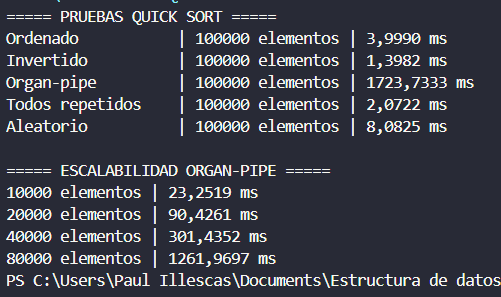

# INVESTIGACIÓN DEL ALGORITMO QUICK SORT

## 1. Identificación del algoritmo

El algoritmo seleccionado para la variante V2 del proyecto es QuickSort, un método de ordenamiento basado en la estrategia de dividir el arreglo. Su finalidad es organizar los elementos de un arreglo de números enteros en orden ascendente o descendente. 

La implementación se encuentra en el archivo `src/MetodosOrd.java`, dentro de la clase `MetodosOrd`.

Los métodos utilizados son:

- `sortQuick(int[] arreglo)`: método público que inicia el proceso de ordenamiento.
- `quickSort(int[] arreglo, int inicio, int fin)`: método privado que realiza las divisiones y continúa el ordenamiento.

La implementación utiliza un pivote ubicado en la posición central del segmento que se está procesando y dos índices para realizar los intercambios.

## 2. Funcionamiento paso a paso

El proceso comienza cuando se invoca el método `sortQuick()`, que recibe un arreglo de tipo `int[]`.

Primero se comprueba que el arreglo no sea nulo. Si recibe un valor `null`, se lanza una excepción `IllegalArgumentException`.

Después se llama al método privado `quickSort()`, enviando el arreglo y los límites iniciales: desde el índice cero hasta la última posición.

El método `quickSort()` utiliza un ciclo `while` que continúa mientras el índice inicial sea menor que el índice final.

En cada iteración se realizan las siguientes operaciones:

1. Se inicializan los índices izquierdo y derecho.
2. Se selecciona el elemento central como pivote.
3. El índice izquierdo avanza mientras encuentre elementos menores que el pivote.
4. El índice derecho retrocede mientras encuentre elementos mayores que el pivote.
5. Cuando los índices no se han cruzado, se intercambian los elementos encontrados.
6. Los índices se actualizan para continuar con la partición.
7. Se ordena recursivamente la partición más pequeña y se continúa iterativamente con la más grande.

El proceso termina cuando los segmentos restantes tienen cero o un elemento.

## 3. Selección del pivote y proceso de partición

La selección del pivote se realiza mediante la expresión:

`int pivote = arreglo[inicio + (fin - inicio) / 2];`

Esta operación selecciona el elemento ubicado en la posición central del segmento actual.

La implementación utiliza dos índices:

- `izquierda`: recorre el arreglo desde el límite inicial hacia la derecha.
- `derecha`: recorre el arreglo desde el límite final hacia la izquierda.

El índice izquierdo avanza mientras encuentre valores menores que el pivote. Por otro lado, el índice derecho retrocede mientras encuentre valores mayores que el pivote.

Cuando ambos índices todavía no se han cruzado, se intercambian los elementos correspondientes. Después, el índice izquierdo aumenta y el derecho disminuye.

Este procedimiento permite colocar los valores en posiciones que favorecen el orden ascendente.

Los elementos repetidos también participan en los intercambios, ya que las condiciones de comparación utilizan los operadores menor que y mayor que. Cuando los valores son iguales al pivote, no se omiten: pueden ser intercambiados y los índices avanzan.

Una característica particular de esta implementación es que realiza una llamada recursiva para la partición más pequeña y continúa con la partición más grande mediante el ciclo `while`.

## 4. Traza manual del algoritmo

Para comprobar el funcionamiento de quicksort usamos el siguiente arreglo como ejemplo.

`[7, 2, 7, 0, 4, 2]`

La traza sigue el comportamiento del método `quickSort()` implementado en la clase `MetodosOrd`, considerando la selección del pivote central, el movimiento de los índices izquierdo y derecho, los intercambios y el procesamiento recursivo e iterativo de los segmentos.

### Primera partición: segmento [0..5]

Arreglo inicial:

`[7, 2, 7, 0, 4, 2]`

- Índice inicial: `inicio = 0`.
- Índice final: `fin = 5`.
- Pivote: `arreglo[2] = 7`.
- Índices iniciales: `izquierda = 0` y `derecha = 5`.

**Primer intercambio:**

El índice izquierdo es 7 y se detiene porque no es menor que el pivote. El índice derecho es 2 y también se detiene porque no es mayor que el pivote. Como los índices no se han cruzado, se intercambian las posiciones 0 y 5.

Resultado:

`[2, 2, 7, 0, 4, 7]`

**Segundo intercambio:**

El índice izquierdo avanza hasta la posición 2, donde el valor es 7. El índice derecho se detiene en la posición 4, donde el valor es 4. Como todavía no se han cruzado, se intercambian las posiciones 2 y 4.

Resultado:

`[2, 2, 4, 0, 7, 7]`

**Finalización de la partición:**

El índice izquierdo avanza desde la posición 3 hasta la posición 4, porque el valor 0 es menor que el pivote. El índice derecho permanece en la posición 3. Los índices se cruzan, por lo que termina esta partición.

**Llamada recursiva sobre [4..5]:**

El segmento contiene los valores `[7, 7]`. Se selecciona 7 como pivote. Como ambos valores son iguales al pivote, los índices se detienen y se intercambian las posiciones 4 y 5. Después, los índices se cruzan y finaliza esta llamada recursiva.

El algoritmo continúa con `fin = 3`.

### Segunda partición: segmento 

Arreglo actual:

`[2, 2, 4, 0, 7, 7]`

- Índice inicial: `inicio = 0`.
- Índice final: `fin = 3`.
- Pivote: `arreglo[1] = 2`.
- Índices iniciales: `izquierda = 0` y `derecha = 3`.

**Primer intercambio:**

El índice izquierdo se detiene en la posición 0, donde esta el 2. El índice derecho se detiene en 3, donde encuentra el valor 0. Como los índices no se han cruzado, se intercambian las posiciones 0 y 3.

Resultado:

`[0, 2, 4, 2, 7, 7]`

**Segundo intercambio:**

El índice izquierdo se detiene en la posición 1 porque encuentra el valor 2, igual al pivote. El índice derecho retrocede desde la posición 2 hasta la posición 1, porque el valor 4 es mayor que el pivote.

Como ambos índices coinciden en la posición 1, se realiza un intercambio del elemento consigo mismo. Luego, los índices se actualizan y se cruzan.

### Tercera partición: 

Arreglo actual:

`[0, 2, 4, 2, 7, 7]`

- Índice inicial: `inicio = 2`.
- Índice final: `fin = 3`.
- Pivote: `arreglo[2] = 4`.
- Índices iniciales: `izquierda = 2` y `derecha = 3`.

**Intercambio:**

El índice izquierdo se detiene en la posición 2, donde encuentra el valor 4. El índice derecho se detiene en la posición 3, donde encuentra el valor 2. Como no se han cruzado, se intercambian las posiciones 2 y 3.

Resultado:

`[0, 2, 2, 4, 7, 7]`

Después del intercambio, los índices se cruzan y finaliza la partición. El segmento restante tiene un solo elemento, por lo que termina el proceso.

### Resultado final

`[0, 2, 2, 4, 7, 7]`

## 5. Análisis de complejidad

El rendimiento de QuickSort depende de cómo se distribuyen las particiones después de seleccionar el pivote.

| Caso | Complejidad temporal | Descripción |
|---|---|---|
| Mejor | O(n log n) | Las particiones tienen tamaños equilibrados. |
| Promedio | O(n log n) | Se consideran particiones suficientemente equilibradas en promedio. |
| Peor | O(n²) | Las particiones quedan muy desequilibradas repetidamente. |

**Complejidad espacial**

La implementación no utiliza un arreglo auxiliar para almacenar los elementos ordenados. Los intercambios se realizan directamente sobre el arreglo original.

El espacio adicional se utiliza principalmente en la pila de llamadas recursivas.

Una característica de esta implementación es que procesa recursivamente la partición más pequeña y continúa iterativamente con la más grande. Esta estrategia limita la profundidad de la recursividad a O(log n) para la implementación descrita.

**Estabilidad del algoritmo**

QuickSort no es un algoritmo estable en esta implementación. Esto significa que no garantiza conservar el orden relativo de elementos que tienen la misma clave.

Esto sucede porque durante el proceso de partición se realizan intercambios entre posiciones del arreglo. Estos intercambios pueden modificar el orden original de elementos repetidos.

## 6. Caso desfavorable de la implementación

En QuickSort, el peor caso temporal se produce cuando las particiones resultan muy desequilibradas de forma repetida. Esto puede provocar que el algoritmo realice una cantidad elevada de comparaciones.

En esta implementación el pivote se selecciona utilizando la posición central del segmento, por lo que el comportamiento desfavorable depende de los valores presentes en esa posición y de cómo se desarrollen las particiones.

Consola de pruebas de casos desfavorables de quicksort.

## 7. Relación con los resultados del benchmark

En las mediciones realizadas se obtuvieron los siguientes tiempos para QuickSort:

Tiempo

10.000

1,9463 ms

50.000

4,4746 ms

100.000

8,1174 ms

Los resultados permiten observar que el tiempo registrado aumentó conforme se incrementó la cantidad de elementos.

## 8. Referencias bibliográficas

1. Coddy Tech. (2026, 1 de julio). *Quick Sort (ordenamiento rápido): algoritmo explicado*. https://coddy.tech/visualize/es/sorting/quick-sort

2. TecnoDigital. (2026, 6 de marzo). *Método de Quicksort en C y Java: Una Guía Completa*. Informatec Digital. https://informatecdigital.com/metodo-de-quicksort-en-c-y-java-una-guia-completa/

3. Sekin Team. (2026, 12 de septiembre). *Método de Quicksort en C y Java: guía completa con ejemplos*. Sekin. https://sekin.in/metodo-de-quicksort-en-c-y-java-guia-completa-con-ejemplos/

4. LabEx. (s. f.). *Algoritmo de clasificación Divide y Vencerás QuickSort eficiente*. https://labex.io/es/tutorials/java-efficient-quicksort-divide-and-conquer-algorithm-117980

