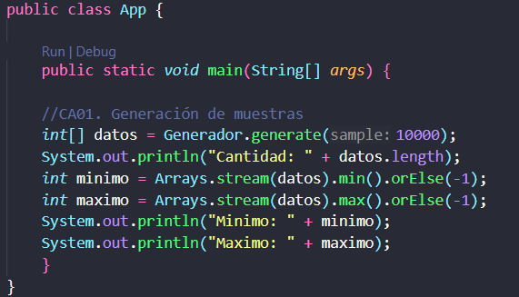
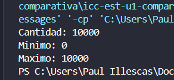
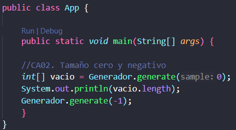
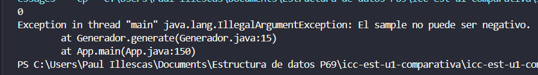
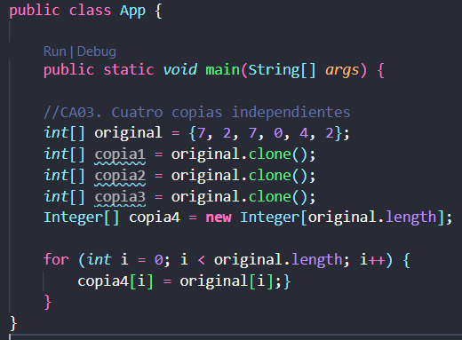
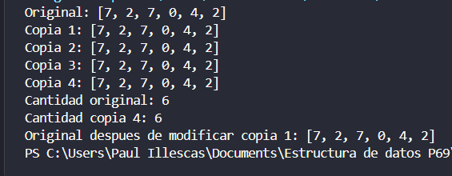
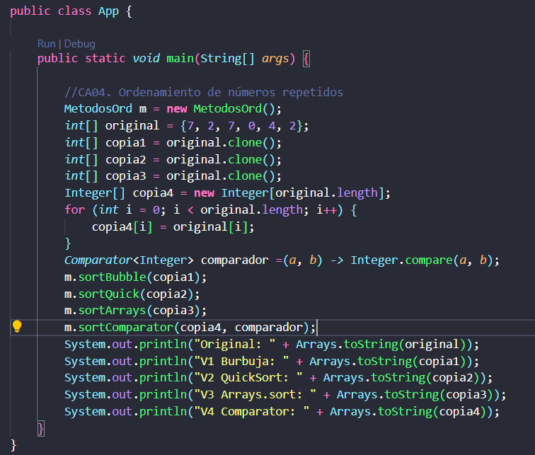
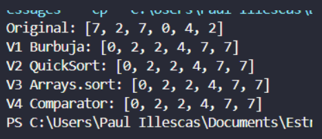
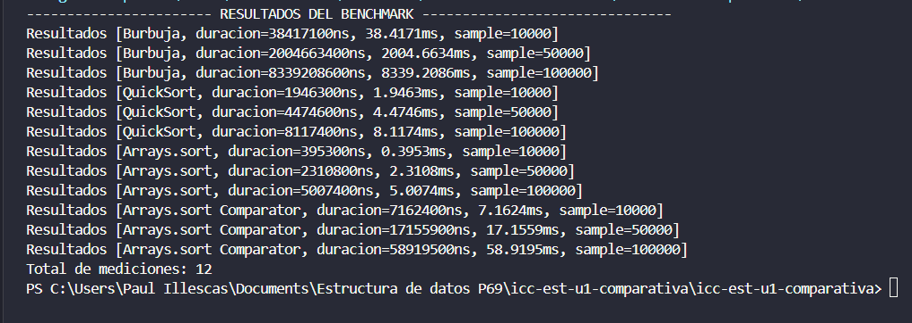

# PL1.1 - Comparativa de métodos de ordenamiento y Benchmarking

Asignatura: Estructura de Datos

Práctica: PL1.1

Título: Comparativa de métodos de ordenamiento y benchmarking

Estudiante: Paul Illescas

Carrera: Computación

Universidad: Universidad Politécnica Salesiana

Fecha: 19/11/2026

# 1. Métodos de ordenamiento utilizados

El proyecto implementa cuatro variantes:

V1. Método Burbuja

Implementación propia del algoritmo Bubble Sort. Compara elementos consecutivos e intercambia sus posiciones cuando están en orden incorrecto.

V2. Quick Sort

Implementación propia del algoritmo Quick Sort. Divide el arreglo mediante particiones alrededor de un pivote hasta conseguir el orden ascendente.

V3. Arrays.sort con int[]

Utiliza el método Arrays.sort() de Java para ordenar un arreglo de tipo primitivo int[].

V4. Arrays.sort con Integer[] y Comparator

Utiliza Arrays.sort() con un arreglo Integer[] y un Comparator<Integer> para establecer el criterio de ordenamiento ascendente.

# 2. Pruebas y evidencias de ejecuion 

Las sigientes pruebas permiten comprobar el funcionamiento
del generador, las copias independientes y los cuatro
métodos de ordenamiento.

## CA01. Generación de muestras
- Entrada: n = 10000, 50000 y 100000.
- Resultado esperado: Generar exactamente n números enteros entre 0 y n, ambos inclusive.

CODIGO

CONSOLA

## CA02. Tamaño cero y negativo
- Entrada: n = 0 y n = -1.
- Resultado esperado: Para cero, devolver un arreglo vacío para un valor negativo, rechazar la solicitud con un error.

CODIGO

CONSOLA

## CA03. Cuatro copias independientes
- Entrada: [7, 2, 7, 0, 4, 2].
- Resultado esperado: Crear cuatro copias con los mismos valores y el mismo orden inicial, sin modificar el original.

CODIGO

CONSOLA

## CA04. Ordenamiento de números repetidos
- Entrada: [7, 2, 7, 0, 4, 2].
- Resultado esperado: Las cuatro variantes deben producir [0, 2, 2, 4, 7, 7].

CODIGO

CONSOLA

# 3. Resultados del Benchmark V1,V2,V3,V4

# 4. BENCHMARK - TABLA DE DATOS 

| Método de ordenamiento | Cantidad de valores | Duración (ns) | Duración (ms) |
|---|---:|---:|---:|
| Burbuja | 10000 | 38417100 | 38.4171 |
| Burbuja | 50000 | 2004663400 | 2004.6634 |
| Burbuja | 100000 | 8339208600 | 8339.2086 |
| QuickSort | 10000 | 1946300 | 1.9463 |
| QuickSort | 50000 | 4474600 | 4.4746 |
| QuickSort | 100000 | 8117400 | 8.1174 |
| Arrays.sort | 10000 | 395300 | 0.3953 |
| Arrays.sort | 50000 | 2310800 | 2.3108 |
| Arrays.sort | 100000 | 5007400 | 5.0074 |
| Arrays.sort Comparator | 10000 | 7162400 | 7.1624 |
| Arrays.sort Comparator | 50000 | 17155900 | 17.1559 |
| Arrays.sort Comparator | 100000 | 58919500 | 58.9195 |

**Total de mediciones: 12**

# 5. CONCLUSIONES

1. Comparación entre algoritmos

En los resultados se observa una diferencia mayor entre Burbuja y QuickSort. Para 100.000 valores, Burbuja registró 8339,2086 ms, mientras que QuickSort necesitó 8,1174 ms. Esto permite observar cómo la elección del algoritmo influye en el tiempo necesario para ordenar numeros grandes.

2. Comparación de las variantes de Java

En las tres muestras, Arrays.sort presentó los menores tiempos de ejecución. Para 100.000 valores obtuvo 5,0074 ms, los 58,9195 ms de Arrays.sort Comparator. Esta diferencia permite analizar cómo la representación de los datos y el uso de un comparador pueden mejorrar el rendimiento.

3. Algoritmo mas veloz 

Al aumentar la cantidad de valores, los tiempos de ejecución también cambiaron, especialmente en el método Burbuja que fue el mas lento. Arrays.sort presentó el mejor rendimiento, por lo que seria el mejor metodo para ordenar numeros grandes. 

